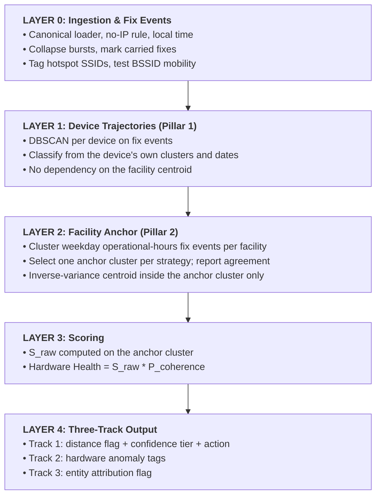
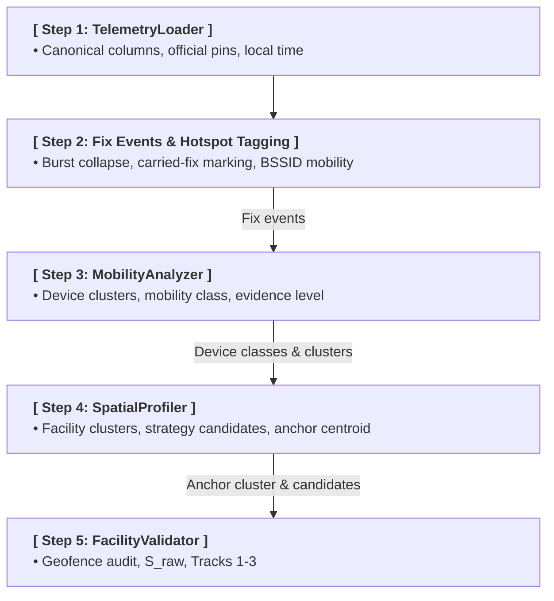
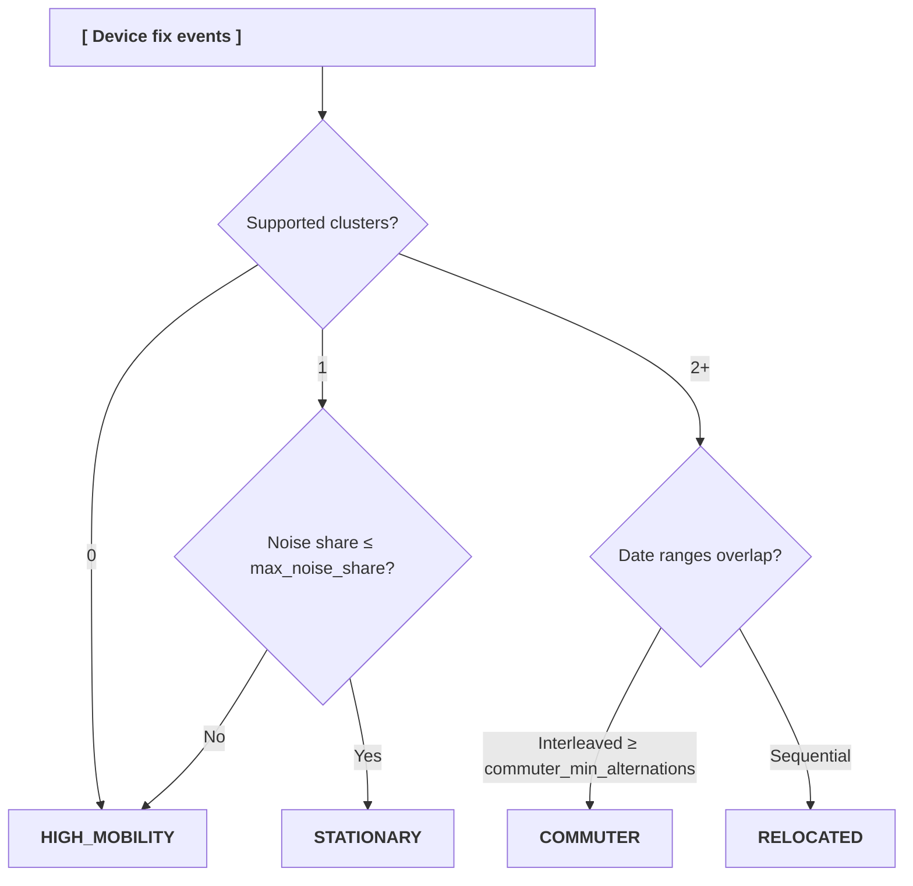
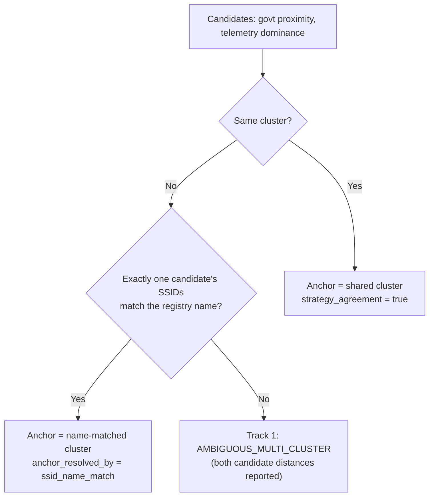
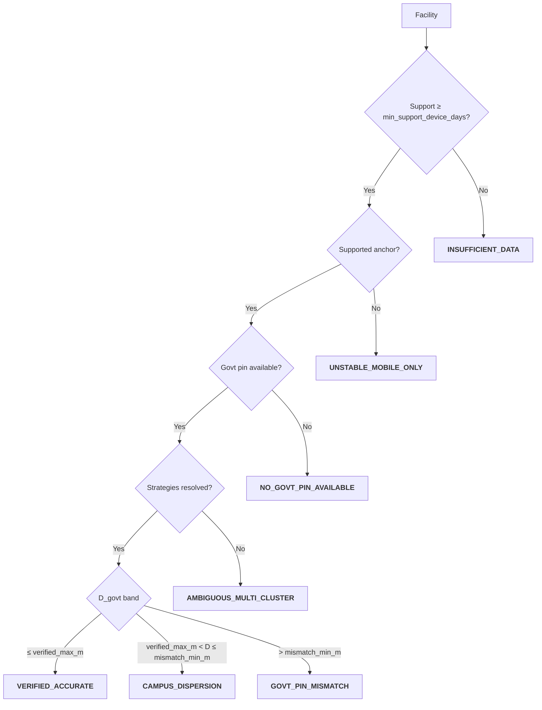

# Geofencing: Technical Blueprint & Research Methodology

**Version:** <span style="background-color: #677eff; color: white; padding: 3px 12px; border-radius: 8px; font-size: 0.9em; font-weight: 500; display: inline-block;">v0.3</span>

**Status:** <span style="background-color: #e91e63; color: white; padding: 3px 12px; border-radius: 8px; font-size: 0.9em; font-weight: 500; display: inline-block;">Draft (design approved, code at v0.2)</span>

**Maturity:** <span style="background-color: #b26a00; color: white; padding: 3px 12px; border-radius: 8px; font-size: 0.9em; font-weight: 500; display: inline-block;">Proposed Baseline</span>

!!! note "Draft status"
    This page describes the v0.3 methodology. The modules under `src/spatial_intelligence/` still implement the previous version until the v0.3 code lands. Numeric settings are listed on the [Parameters](parameters.md) page; values marked *proposed* are starting points for calibration, not fixed rules. How the method got here is recorded in the [Research Log](research-log.md).

## 1\. Objective

The primary objective of this framework is to replace static, self-reported administrative registries with spatially verified, crowdsourced field telemetry. By capturing Wi-Fi geolocation results and active speedtests via the GigaMeter application, the system calculates location truth, evaluates device mobility trajectories, cross-validates official government records, and checks whether the telemetry is attributable to the registered entity.

### 1.1 The 3 Research Pillars

| Pillar Name | Primary Input Data | Core Methodologies | Primary Output / Operational Value |
| ---| ---| ---| --- |
| Pillar 1: Entity Geofencing & Mobility | Device fix events, `device_id`, local timestamps | Per-device DBSCAN on fix events, support by device-days, date interleaving | Mobility classification (`STATIONARY`, `COMMUTER`, `RELOCATED`, `HIGH_MOBILITY`) with a separate evidence level. |
| Pillar 2: Geolocation Quality & Confidence | Google API resolved lat/lon, accuracy, BSSIDs, SSIDs | Fix events, BSSID mobility test, facility observation clusters, inverse-variance centroids, 5-factor score, BSSID Coherence Penalty | Facility anchor cluster, unpenalized location score (S\_raw), mobile hotspot tags, hardware health score. |
| Pillar 3: Government Data Validation | Anchor centroid, official registry pins, registry names | Haversine displacement (D\_govt), strategy agreement, Three-Track Engine | Decoupled flags: location truth with confidence tier, hardware anomaly tags, entity attribution. |

### 1.2 Multi-Track Engine

A facility can be correctly located while its monitoring hardware is unreliable, and the reverse. A single combined flag would hide one answer behind the other, so the engine reports independent tracks. No track's output is folded into another track's flag.

1. **Track 1: Location Truth Engine (Pillar 3):** Where is the facility anchor relative to the official pin, and how much evidence supports that answer?
2. **Track 2: Hardware Integrity Engine (Pillars 1 & 2):** Are the monitoring devices a trustworthy installation (stationary, fixed infrastructure, no splits)?
3. **Track 3: Entity Attribution Engine (Pillar 3):** Is the anchor plausibly the registered entity, rather than another facility or a private location?

Later versions may add tracks.

## 2\. Evidence Unit: Fix Events

Each speedtest triggers a fresh lookup: the client scans the associated and nearby Wi-Fi access points, and the backend resolves that list through the Google Geolocation API into `detected_latitude`, `detected_longitude`, and `detected_location_accuracy`.

Many consecutive rows from one device still carry exactly the same `(lat, lon, accuracy)`. Three situations produce this:

*   **Bursts:** several tests seconds or minutes apart.
*   **Unchanged environment:** a later test sees the same access points and Google returns the same answer. This is genuine repeated evidence.
*   **Carried fixes:** the same coordinates appear under a different associated network, sometimes kilometres from that network's other fixes. The cause is not confirmed (see [Known Limitations](#9-known-limitations)).

Counting rows overstates evidence, and carried fixes attach coordinates to the wrong network.

Rows are converted to **fix events** per device, in time order:

1. **Burst collapse:** Consecutive rows with the same fix within `burst_window_s` form one event.
2. **Fresh repeat:** The same fix under the same BSSID after a longer gap is a new event. It adds support (another session or day) but the centroid weights each event once, not each row.
3. **Carried fix:** Consecutive rows with the same fix form a *run*; the run's origin network is the first associated BSSID in it. A row whose BSSID differs from its run's origin network is marked `fix_carried = True`. It is excluded from BSSID mobility tests, BSSID centroids, and cluster support, and remains available to non-spatial analyses. Rows with no associated network are never carried and do not set the origin, because a device switching between cable and Wi-Fi in one place legitimately gets the same answer. Excluding a carried row loses no location: the same coordinates are already counted under the origin network.

**Support** for a location is counted in distinct device-days of non-carried fix events, then distinct devices, then events.

## 3\. Layered Architecture (Device-First)

### 3.1 Layer Overview



1. **MobilityAnalyzer answers:** _"How does each device move, on its own terms?"_
2. **SpatialProfiler answers:** _"Which observed location is the facility, and how well is it supported?"_
3. **FacilityValidator answers:** _"Does that location match the government map (Track 1), is the hardware reliable (Track 2), and is the telemetry attributable to this entity (Track 3)?"_

### 3.2 Processing Sequence

The chain stays one-way. `MobilityAnalyzer` no longer needs a facility summary; the profiler consumes device classes, which makes `STATIONARY_FIRST` possible. Geofence compliance against the anchor becomes an audit computed after Layer 2.



## 4\. Pillar 1: MobilityAnalyzer Logic

### 4.1 Processing Passes

*   **Pass 1: Input:** The device's non-carried fix events, all hours. Weekends are kept because they carry commuting and relocation signal.
*   **Pass 2: DBSCAN:** Haversine metric on fix events with `device_eps_m` and `device_min_samples` (counted in events, not rows).
*   **Pass 3: Support:** A cluster is *supported* when it spans at least `min_cluster_device_days` distinct days. Unsupported clusters are treated as noise.
*   **Pass 4: Classification:** Uses the device's own supported clusters and their date ranges. Cluster labels carry no meaning; the dominant cluster is the one with the most support, not cluster `0`.

### 4.2 Classification Rules



| Mobility Class | Rule | Real-World Context |
| ---| ---| --- |
| `STATIONARY` | Exactly one supported cluster and noise share &le; `max_noise_share` | Fixed desktop or router-attached device. |
| `COMMUTER` | Two or more supported clusters whose visits alternate across days | Staff laptop moved between the facility and home. |
| `RELOCATED` | Two or more supported clusters in sequence (one ends before the next begins) | Equipment transferred, or facility moved. |
| `HIGH_MOBILITY` | No supported cluster, or noise share above the limit | Roaming hotspot, personal phone, field kit. |

Mobility class and amount of evidence are separate fields. Each device also reports `evidence_device_days`, so a stationary device seen on 3 days and one seen on 60 days share a class but not an evidence level.

## 5\. Pillar 2: SpatialProfiler Logic

### 5.1 Data Ingestion Rules

1. **No-IP Policy:** Rows with null `detected_latitude` or `detected_longitude` are dropped. `client_info` IP coordinates are never used as facility pins.
2. **Anchor Window:** Facility clustering uses fix events inside 08:00:00–19:59:59 local time on configured `workdays`. Device mobility (Layer 1) uses all hours.
3. **Fix Events:** As defined in Section 2.

### 5.2 Hotspot & BSSID Mobility Signals

*   **SSID regex:** A case-insensitive consumer hotspot pattern (`hotspot_ssid_pattern`, for example `iphone`, `galaxy`, `hotspot`, `mifi`) sets `is_hotspot_ssid`.
*   **BSSID mobility (`is_mobile_bssid`):** Keep fix events for one BSSID with accuracy &le; `bssid_mobility_accuracy_gate_m`, excluding carried fixes. Run DBSCAN with `bssid_mobility_eps_m` and `bssid_mobility_min_samples`. The BSSID is mobile when two or more clusters each span at least `bssid_mobility_min_cluster_days`. A single stray reading cannot mark a fixed router as mobile.
*   **Locally administered MAC bit:** Recorded as `is_laa_bssid`. Phone hotspots commonly randomise their MAC, but mesh routers also set this bit, so it is evidence, not a trigger.
*   `is_mobile_hotspot = is_hotspot_ssid OR is_mobile_bssid`.

### 5.3 Facility Observation Clusters

The facility is located from clusters of observations, not from BSSIDs. A BSSID can appear at more than one place, and many tests have no associated BSSID at all (wired or unassociated devices), so grouping by BSSID cannot separate locations.

1. Run DBSCAN (`anchor_eps_m`) on the facility's anchor-window fix events from all devices, including events without a BSSID.
2. Each cluster records its BSSIDs, SSIDs, devices, device-days, event count, hotspot share, and mean accuracy.
3. Clusters dominated by hotspot events are excluded when a non-hotspot cluster exists.
4. **Anti-blending invariant:** a centroid is only ever computed inside one cluster. No facility coordinate is an average across clusters.

### 5.4 Strategy Candidates & Agreement

Each strategy selects one candidate cluster. Ranking within a strategy is by support (device-days, then devices, then events).

*   **`GOVT_PROXIMITY_ANCHOR`:** Highest-support cluster with its centroid within `govt_anchor_radius_m` of the official pin. Distance to the pin only breaks support ties. Falls back to `TELEMETRY_DOMINANCE` when no cluster is in range.
*   **`TELEMETRY_DOMINANCE`:** Highest-support cluster, ignoring the pin.
*   **`STATIONARY_FIRST`:** Highest-support cluster built only from events of `STATIONARY` devices and the dominant cluster of `COMMUTER` devices. Falls back to `TELEMETRY_DOMINANCE` when none exist.

The default run evaluates `GOVT_PROXIMITY_ANCHOR` and `TELEMETRY_DOMINANCE`:



**Registry name match:** The registry name and SSID are lowercased, stripped of diacritics, and cleaned of generic tokens (`name_match_generic_tokens`, for example `shkolla`, `school`, grade labels, band suffixes such as `2.4g`). The match holds when every remaining token of the registry name appears in the SSID. It is used only to break a strategy disagreement and is always recorded.

Every facility reports `anchor_cluster_id`, `anchor_bssids`, `strategy_candidates`, `strategy_agreement`, `anchor_resolved_by`, and `strategy_fallback_reason`.

### 5.5 Accuracy-Weighted Centroid

Inside the anchor cluster, each fix event gets one weight:

$$w_i = \frac{1}{\max(A_i, A_{\text{floor}})^2}, \quad \bar{\phi} = \frac{\sum w_i \phi_i}{\sum w_i}, \quad \bar{\lambda} = \frac{\sum w_i \lambda_i}{\sum w_i}$$

Because averaging is confined to one cluster, the planar lat/lon mean is adequate at campus scale.

## 6\. FacilityValidator: Scoring & Tracks

### 6.1 Raw Score (S\_raw)

Five factors are computed on the **anchor cluster**, not on all of the facility's telemetry, so evidence from other locations does not raise or lower the anchor's confidence.

$$S_{\text{raw}} = S_{\text{stability}} + S_{\text{consensus}} + S_{\text{bssid}} + S_{\text{depth}} + S_{\text{precision}}$$

| Component | Max | v0.3 input |
| --- | --- | --- |
| S\_stability | 30 | Mobility classes of devices contributing to the anchor cluster |
| S\_consensus | 25 | Max distance between each contributing device's dominant supported cluster centroid (single device: 12.5) |
| S\_bssid | 20 | Non-hotspot BSSIDs in the anchor cluster and their active days |
| S\_depth | 15 | Distinct device-days in the anchor cluster |
| S\_precision | 10 | Mean accuracy of anchor fix events |

Breakpoints are on the [Parameters](parameters.md) page.

### 6.2 Track 1: Location Truth

The flag is set by distance alone. Confidence is a separate tier, and the recommended action combines both.



**Confidence tier** (`location_confidence_level`) from S\_raw: `HIGH`, `MEDIUM`, `LOW`.

**Recommended action** (`recommended_action`):

| Condition | Action |
| --- | --- |
| `GOVT_PIN_MISMATCH`, `HIGH`, anchor supported by 2+ devices | `SUBMIT_CORRECTION` |
| `GOVT_PIN_MISMATCH` or `CAMPUS_DISPERSION` with `MEDIUM`, or any single-device anchor | `FIELD_VERIFY` |
| Any flag with `LOW` | `AWAIT_DATA` |
| `VERIFIED_ACCURATE`, `HIGH` or `MEDIUM` | `NONE` |
| `AMBIGUOUS_MULTI_CLUSTER` | `FIELD_VERIFY` |

`govt_displacement_m` is reported whenever an anchor and a pin exist, whatever the flag.

A stationary single-device anchor proves the device does not move, not that it sits in the facility. This is why single-device mismatches route to `FIELD_VERIFY`.

### 6.3 Track 2: Hardware Integrity

$$\text{Hardware Health} = S_{\text{raw}} \times P_{\text{coherence}}$$

$D_{\text{split}}$ is the maximum distance between **supported** facility clusters. Unsupported stray readings do not contribute.

$$P_{\text{coherence}} = 
\begin{cases} 
1.0, & \text{if } D_{\text{split}} \le \text{coherence\_full\_m} \\[1ex]
1.0 - 0.5 \times \left( \frac{D_{\text{split}} - \text{coherence\_full\_m}}{\text{split\_m} - \text{coherence\_full\_m}} \right), & \text{if } \text{coherence\_full\_m} < D_{\text{split}} \le \text{split\_m} \\[1ex]
\text{coherence\_floor}, & \text{if } D_{\text{split}} > \text{split\_m}
\end{cases}$$

| Anomaly Tag | Trigger |
| --- | --- |
| `BSSID_SPATIAL_SPLIT` | $D_{\text{split}}$ > `split_m` |
| `HOTSPOT_TETHERED_FACILITY` | Share of non-carried fix events tagged `is_mobile_hotspot` &ge; `hotspot_share_min` |
| `COMMUTER_DEVICE` | At least one contributing device is `COMMUTER` |
| `RELOCATED_DEVICE` | At least one device is `RELOCATED` |

### 6.4 Track 3: Entity Attribution

Track 3 never changes the Track 1 flag. Its only interaction with Track 1 is the registry-name tie-break in Section 5.4, which is recorded in `anchor_resolved_by`.

| Field | Meaning |
| --- | --- |
| `ssid_name_match` | Anchor SSIDs match the registered entity name (Section 5.4 rule) |
| `nearest_other_entity_id`, `nearest_other_entity_distance_m` | Closest official pin of a *different* entity in the same country table |

| Attribution Flag | Trigger |
| --- | --- |
| `CONSISTENT` | `ssid_name_match` is true, or this entity's pin is the nearest official pin to the anchor |
| `OTHER_ENTITY_NEARBY` | Another entity's pin is within `other_entity_radius_m` of the anchor and no name match supports this entity |
| `UNRESOLVED` | Neither signal is available |

Track 3 needs the country school table from the same source the loader already reads. The canonical telemetry frame and its column contract do not change.

## 7\. Output Schema

```json title="Facility Evaluation Payload (v0.3 draft)"
{
  "school_id_giga": "SCH_12345",
  "methodology_version": "0.3",
  "config_hash": "…",

  "location_verification_flag": "GOVT_PIN_MISMATCH",
  "location_confidence_score": 62.5,
  "location_confidence_level": "MEDIUM",
  "recommended_action": "FIELD_VERIFY",
  "govt_displacement_m": 14800.0,
  "anchor_cluster_id": 2,
  "anchor_bssids": ["…"],
  "anchor_support_device_days": 3,
  "strategy_candidates": {"govt_proximity_anchor": 2, "telemetry_dominance": 2},
  "strategy_agreement": true,
  "anchor_resolved_by": "strategy_agreement",
  "strategy_fallback_reason": "no_cluster_within_govt_anchor_radius",

  "hardware_health_score": 62.5,
  "hardware_anomaly_tags": [],

  "entity_attribution_flag": "UNRESOLVED",
  "ssid_name_match": false,
  "nearest_other_entity_distance_m": null
}
```

## 8\. Data Dictionary Rules

*   **Measurement Source:** `source = 'DailyCheckApp'`. The app-version filter must compare versions numerically, not as strings.
*   **Timezone:** UTC `created_timestamp` is converted to local time before any operational-hours or workday rule.
*   **No-IP Policy:** Never impute `detected_*` from `client_info`. Drop null coordinates before spatial work.
*   **Fix Events:** All spatial evidence is counted in fix events and device-days, never raw rows.

## 9\. Known Limitations

*   **No term calendar:** School holidays are not modelled. Over a long holiday a staff laptop's home cluster can out-support the facility cluster, which surfaces as a strategy disagreement.
*   **Fixed workdays:** `workdays` is one config value, not resolved per country.
*   **Carried-fix cause:** Each test runs a fresh lookup and a failed lookup is not replaced by an earlier result, yet carried fixes are observed. Candidate causes are a Wi-Fi scan list returned from the operating system's cache (for example after sleep and resume) or caching of lookup results in the backend. Neither is confirmed, and the stored ledger does not include the nearby access-point list needed to tell them apart. The carried-fix rule is inferred from the data and does not depend on the cause. A lookup timestamp in the payload would make it observable; this is not planned for v0.3.
*   **SSID semantics:** SSIDs are user-set. Name matching is a tie-breaker and Track 3 evidence only.
*   **Score double-count:** S\_bssid and S\_depth both reward active days. Kept unchanged pending calibration.

## 10\. Validation Plan

1. Replay the previous and the current version on the same country ledger and publish the flag transition matrix in the [Research Log](research-log.md).
2. Check the [Worked Examples](../spatial/examples.md) against their expected v0.3 outputs.
3. Hand-review a random sample from each v0.3 Track 1 flag and each confidence tier.
4. Report how many BSSIDs lose their mobility tag after carried fixes are excluded.
5. Freeze 0.3 and publish with `mike` only after these checks pass.
