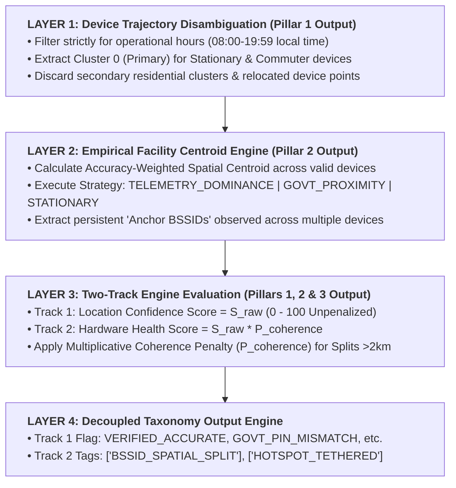
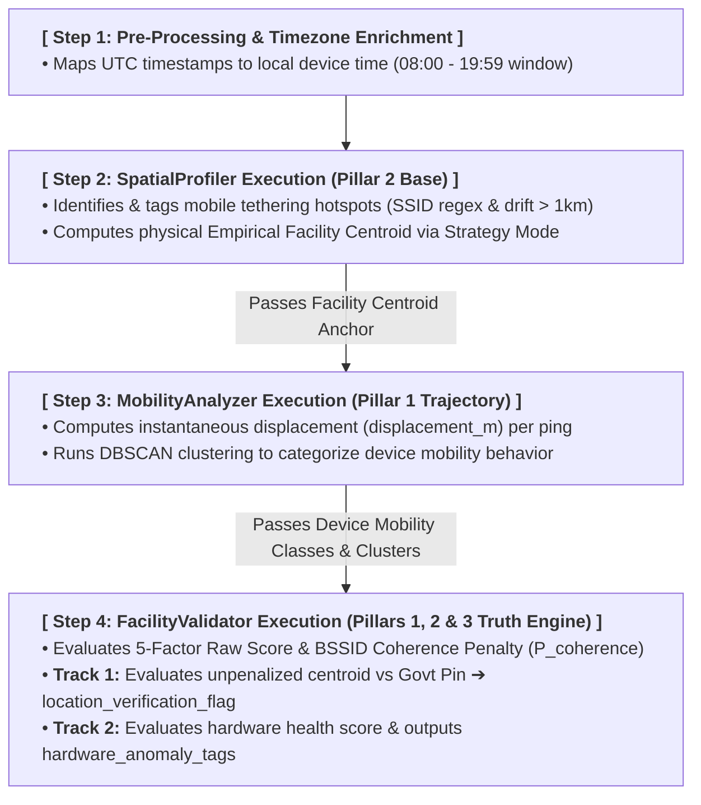
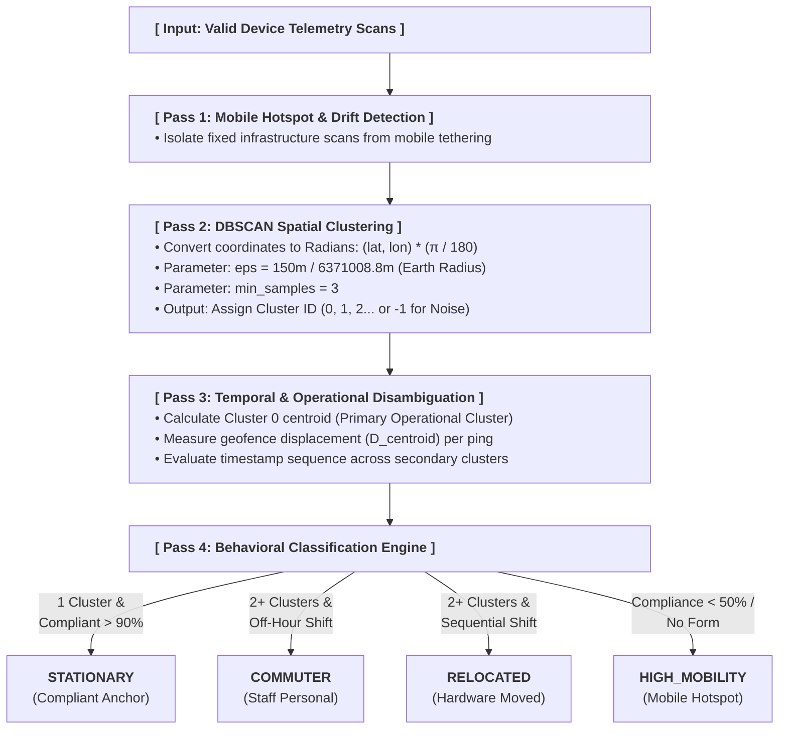
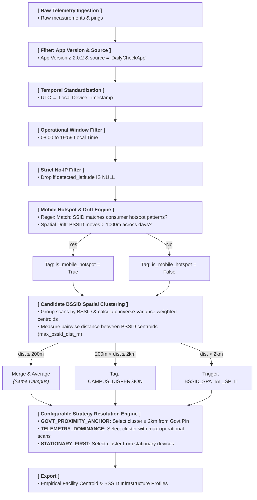
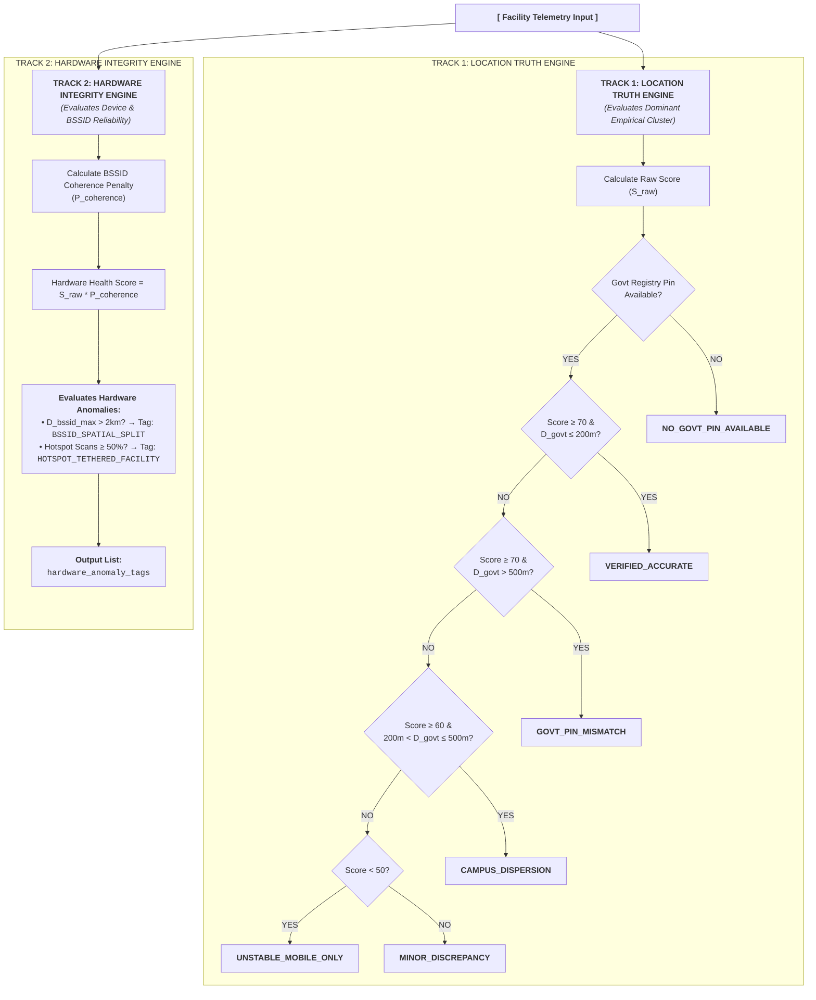

# Geofencing: Technical Blueprint & Research Methodology

**Version:** v0.2

**Status:** Hardening (exploring edge cases)

**Maturity:** Active Baseline

## 1\. Objective
The primary objective of this framework is to replace static, self-reported administrative registries with spatially verified, crowdsourced field telemetry. By capturing background Wi-Fi BSSID environmental scans and high-frequency active speedtests via the GigaMeter application, the system dynamically calculates location truth, evaluates device mobility trajectories, and cross-validates official government administrative records.

### 1.1 The 3 Research Pillars Fall Under This Topis

| Pillar Name | Primary Input Data | Core Methodologies | Primary Output / Operational Value |
| ---| ---| ---| --- |
| Pillar 1: Entity Geofencing & Mobility | Time-series coordinates, `device_id`, timestamps | DBSCAN clustering (eps=150m), operational window (08:00–19:59) | Mobility classification (`STATIONARY`, `COMMUTER`, `RELOCATED`, `HIGH_MOBILITY`). |
| Pillar 2: Geolocation Quality & Confidence | Google API resolved lat/lon, accuracy, BSSIDs, SSIDs | Inverse-variance weighted centroids, 5-factor scoring model, BSSID Coherence Penalty | Unpenalized location score (S\_raw​), mobile hotspot tags, hardware health score. |
| Pillar 3: Government Data Validation | Empirical facility centroids, official government registry pins | Haversine displacement (D\_govt​), Two-Track Engine Architecture | Decoupled location verification flags (`VERIFIED_ACCURATE`, `GOVT_PIN_MISMATCH`, etc.). |

### 1.2 The Two-Track Engine Paradigm Shift
Earlier iterations of spatial validation utilized a single-flag cascade where severe hardware volatility (e.g., a laptop transported 200km between a school and a regional office) or high mobile hotspot usage forced the system into outputting a single flag such as `BSSID_SPATIAL_SPLIT`. This created an analytical paradox: even if the primary spatial cluster matched the official government registry pin perfectly (<= 30m), the single-flag system masked the verified physical building location under a hardware anomaly tag.

To eliminate this paradox, `v0.2` introduces the Two-Track Engine Architecture, cleanly decoupling two independent research dimensions:

1. **Track 1: Location Truth Engine (Pillar 3 Focus):** Evaluates the physical location of the brick-and-mortar facility against official government administrative records using the unpenalized spatial confidence score (S\_raw, 0–100) of the primary empirical cluster.
2. **Track 2: Hardware Integrity Engine (Pillars 1 & 2 Focus):** Evaluates device deployment permanence, mobile hotspot dependency, and spatial split anomalies (> 2km), applying a multiplicative BSSID Coherence Penalty (P\_coherence) to yield a dedicated `hardware_health_score` and decoupled `hardware_anomaly_tags`.

## 2\. 4-Layer Facility Location & Consolidation Architecture
### 2.1 Overview & Pillar Integration Mechanics
Raw crowdsourced telemetry contains significant spatial noise introduced by personal mobile tethering (teacher smartphones), staff commuter devices, and hardware relocations. To transform raw Wi-Fi BSSID environmental scans into an empirical location truth engine, processing is organised into a 4-Layer Consolidation Framework.

This 4-layer model directly operationalises our core research pillars:
*   Layer 1 executes Pillar 1 (`MobilityAnalyzer`) to isolate device-level mobility trajectories and extract primary operational clusters.
*   Layer 2 executes Pillar 2 (`SpatialProfiler`) to calculate accuracy-weighted empirical centroids across persistent fixed infrastructure.
*   Layer 3 executes the composite scoring engine inside `FacilityValidator` to measure hardware stability, multi-device spatial consensus, and BSSID coherence.
*   Layer 4 completes Pillars 1, 2 & 3 (`FacilityValidator`) by cross-validating empirical centroids against official government administrative coordinates to output decoupled primary location flags and secondary hardware anomaly tags.

### 2.2 Architectural Blueprint & Layer Progression

1. **SpatialProfiler answers:** _"Where is the physical building located?"_

2. **MobilityAnalyzer answers:** _"How are the individual devices moving relative to that building?"_

3. **FacilityValidator answers:** _"Can we verify the building location on government maps (Track 1), and how reliable is the installed monitoring hardware (Track 2)?"_

## 2.3 Processing Sequence & Module Dependency Chain
To ensure data integrity and prevent circular import issues in code execution, the pipeline components run in a strict, unidirectional dependency chain:

## 3\. Pillar 1: MobilityAnalyzer Blueprint & Logic
### 3.1 Overview & Trajectory Disambiguation
The `MobilityAnalyzer` module evaluates hardware movement trajectories at the individual `device_id` level. It utilizes DBSCAN (Density-Based Spatial Clustering of Applications with Noise) with a native Haversine metric to group geographic locations into spatial clusters without requiring a pre-defined cluster count.
#### Processing Passes:
*   **Pass 1: Mobile Hotspot & Drift Filtering**: Identifies personal mobile hotspots and tags high-volatility BSSIDs to prevent consumer phones from skewing hardware trajectory analysis.
*   **Pass 2: Density-Based Spatial Clustering (DBSCAN)**: Groups valid coordinate pairs per device using a spatial radius threshold (eps = 150 meters) and a minimum density threshold (min\_samples = 3).
*   **Pass 3: Temporal & Operational Disambiguation**: Evaluates scan distributions across clusters during active operational hours (08:00–19:59) vs. off-hours/weekends.
*   **Pass 4**: Behavioral Classification & Geofence Auditing: Classifies hardware behavior into four operational states: `STATIONARY`, `COMMUTER`, `RELOCATED`, or `HIGH_MOBILITY`.
### 3.2 Multi-Pass Device Mobility Engine Flowchart

## 3.3 Summary Comparison Table of Mobility Classes

| Mobility Class | Cluster Count (K) | Spatial Pattern | Temporal Behavior | Real-World Operational Context |
| ---| ---| ---| ---| --- |
| `STATIONARY` | 1 Primary Cluster | Tight spatial anchor (<=150m - 200m) | High compliance (>= 90%) across all days and hours | Dedicated, fixed desktop or router monitoring hardware anchored to the school building. |
| `COMMUTER` | 2+ Clusters | Alternates between Cluster 0 (School) and Cluster 1+ (Home/Off-site) | Cluster 0 during active hours (08:00–19:59); Cluster 1 off-hours and weekends | Mobile laptop or tablet owned by a teacher/staff member who brings it to work and takes it home. |
| `RELOCATED` | 2+ Clusters | Permanent geographic shift from Cluster A to Cluster B | Strictly Cluster A before Date T; strictly Cluster B after Date T | Equipment permanently transferred to another facility, stolen, or school physically relocated. |
| `HIGH_MOBILITY` | Many / Noise | Low geofence compliance (< 50%) or scattered spatial points | Volatile across days and operational hours | Roaming mobile hotspot, staff personal smartphone, or field audit kit. |

## 4\. Pillar 2: SpatialProfiler Blueprint & Logic
### 4.1 Overview & Data Ingestion Rules
The `SpatialProfiler` module serves as the **foundational spatial processing engine**. It ingests raw telemetry measurements, standardizes facility identifiers (`school_id_giga`), enriches records with local device timestamps, and tags consumer mobile hotspots, and resolves empirical facility centroids using configurable strategy modes.
#### Processing Rules:
1. **Strict No-IP Fallback Policy:** The profiler strictly discards records where `detected_latitude` or `detected_longitude` is `null`. IP-based geolocation fallback is never applied.
2. **Operational Window Isolation:** Time-series telemetry is filtered strictly between 08:00:00 and 19:59:59 local device time (`is_operational_hours = True`) to prevent nighttime or off-hour device transport from skewing facility locations.
3. **Consumer Hotspot & Drift Engine:**
    1. **SSID Regex Pattern Matching:** Passive and active SSIDs are evaluated against a consumer hotspot pattern:
        1. Pattern = (?i)(iphone\\android\\galaxy\\hotspot\\teacher\\pixel\\redmi\\tether\\samsung\\huawei\\oppo\\vivo\\xiaomi\\realme\\mobicom\\unitel\\mifi)
    2. **Multi-Day Spatial Drift Check:** BSSIDs displaying multi-day spatial drift exceeding 1000m across different dates are tagged as `is_hotspot_drift = True`.
4. **Candidate BSSID Spatial Clustering & Spatial Splits:**
    *   Pairwise distances (D\_bssid) between BSSID centroids are calculated.
    *   D\_bssid <= 200m → Merged & averaged (same physical campus/building).
    *   200m < D\_bssid \\<= 2000m → Retained as minor campus dispersion.
    *   D\_bssid > 2000m → Triggers `BSSID_SPATIAL_SPLIT` anomaly tag.

### 4.2 Configurable Primary Cluster Resolution Strategies

To address BSSID splits (> 2km) without introducing analytical bias, `SpatialProfiler` supports three configurable resolution modes:

*   **Mode 1:** `GOVT_PROXIMITY_ANCHOR` **(Prior-Informed Default):** If a BSSID split occurs, the engine checks if any candidate cluster centroid is <= 2000m from official government coordinates (phi\_govt, lambda\_govt). If candidate clusters exist near the government pin, it selects the cluster with the highest operational scan density among them.

*   **Mode 2:** `TELEMETRY_DOMINANCE` **(Unbiased Field Benchmark):** Evaluates spatial data strictly based on scan volume during active operational hours (08:00–19:59), ignoring government coordinates entirely. Ideal for Pillar 3 auditing without circular reasoning.

*   **Mode 3:** `STATIONARY_FIRST` **(Hardware-First Mode):** Filters candidate clusters for scans originating strictly from devices classified as `STATIONARY` before computing the facility centroid.

### 4.3 Spatial Profiling & Aggregation Engine Flowchart

##   

## 5\. Pillar 3 & 4: FacilityValidator & Two-Track Engine Mechanics
### 5.1 Overview & Two-Track Engine Logic
The `FacilityValidator` module consolidates multi-device spatial clusters into a Two-Track Validation Engine. It bridges empirical field telemetry with administrative metadata to evaluate two independent tracks: Location Truth (Pillar 3) and Hardware Health (Pillars 1 & 2).
### 5.2 Comprehensive 5-Factor Score Component Breakdown
The raw spatial confidence score (S\_raw, 0–100) evaluates five distinct spatial and operational dimensions of the primary empirical cluster:

$$S_{\text{raw}} = S_{\text{stability}} + S_{\text{consensus}} + S_{\text{bssid}} + S_{\text{depth}} + S_{\text{precision}}$$

| Component Name | Max Points | Tracked Inputs & Metrics | Mathematical Logic & Evaluation Rules | Operational Impact & Thresholds |
| ---| ---| ---| ---| --- |
| 1\. Device Stability Profile (S\_stability) | 30 pts | Categorical mobility class of all devices registered to facility (`STATIONARY`, `COMMUTER`, `RELOCATED`, `HIGH_MOBILITY`). | `if STATIONARY in devices: score = 30.0`  `elif COMMUTER in devices: score = 20.0`  `else: score = 10.0`  | Evaluates hardware permanence. Awarded 30 points if at least one stationary device anchors the building. |
| 2\. Multi-Device Spatial Consensus (S\_consensus) | 25 pts | Maximum pairwise Haversine distance (d\_max in meters) between primary cluster centroids across multiple devices. | `if d_max <= 30: score = 25.0`  `elif 30 < d_max <= 200:`  `score = 25.0 * (1.0 - (d_max - 30) / 170.0)`  `else: score = 0.0`  (Single-device default = 12.5 pts)  | Evaluates whether distinct hardware devices agree on facility location. d\_max > 200m indicates conflicting hardware setups. |
| 3\. BSSID Infrastructure Persistence (S\_bssid) | 20 pts | Presence of fixed, non-null BSSIDs and active operational days recorded with valid BSSIDs. | `if bssid_exists and days_active >= 3:`  `score = 20.0`  `else: score = 10.0`  | Rewards persistent Wi-Fi router infrastructure. Ambient background scans without associated BSSIDs receive 10 points. |
| 4\. Data Temporal Depth (S\_depth) | 15 pts | Count of unique operational days recorded in the observation window. | `score = min(15.0, 15.0 * (days_active / 10.0))`  | Scales linearly up to 10 active days. Reaching 10+ operational days awards the full 15 points. |
| 5\. API Precision Radius (S\_precision) | 10 pts | Mean reported Google Geolocation API accuracy radius (mean\_acc in meters). | `score = max(0.0, 10.0 * (1.0 - (mean_acc - 10) / 90.0))`  | Evaluates precision returned by Google API. mean\_acc <= 10m receives 10 points; mean\_acc >= 100m receives 0 points. |

### 5.3 BSSID Coherence Penalty Factor (P\_coherence)
The BSSID Coherence Penalty measures spatial agreement across all BSSIDs associated with a facility (D\_bssid\_max in meters). It is applied strictly to Track 2 (Hardware Health) to penalize roaming hardware without degrading Track 1 (Location Truth):

$$P_{\text{coherence}} = 
\begin{cases} 
1.0, & \text{if } D_{\text{bssid_max}} \le 1000\text{m } \text{(Tight Alignment)} \\[1ex]
1.0 - 0.5 \times \left( \frac{D_{\text{bssid_max}} - 1000}{1000} \right), & \text{if } 1000\text{m} < D_{\text{bssid_max}} \le 2000\text{m} \\[1ex]
0.1, & \text{if } D_{\text{bssid_max}} > 2000\text{m } \text{(Severe BSSID Split)}
\end{cases}$$

$$\text{Track 1 (Location Confidence Score)} = S_{\text{raw}}$$

$$\text{Track 2 (Hardware Health Score)} = S_{\text{raw}} \times P_{\text{coherence}}$$

## 6\. Two-Track Decoupled Taxonomy Engine Flowchart
The parallel evaluation flowchart demonstrates how Track 1 (Location Truth) and Track 2 (Hardware Integrity) execute independently:

## 7\. Decoupled Taxonomy Output Matrix
### 7.1 Track 1: Primary Location Verification Flags (Pillar 3)

| Location Flag | Trigger Conditions | Real-World Operational Interpretation | Recommended Action |
| ---| ---| ---| --- |
| `VERIFIED_ACCURATE` | S\_raw >= 70.0 AND D\_govt <= 200m | Field telemetry confirms official government registry coordinates. High-confidence baseline established. | None. Facility baseline verified. |
| `GOVT_PIN_MISMATCH` | S\_raw >= 70.0 AND D\_govt > 500m | Empirical telemetry is spatially stable, but government coordinates are significantly inaccurate (e.g., pinned to village center or district office). | Submit spatial coordinate correction to Ministry. |
| `CAMPUS_DISPERSION` | S\_raw >= 60.0 AND 200m < D\_govt <= 500m | Telemetry confirms presence near the government pin, but spatial spread reflects a large multi-building campus, sports field, or peripheral annex. | Retain location as valid; flag for minor boundary refinement. |
| `UNSTABLE_MOBILE_ONLY` | S\_raw < 50.0 | Telemetry is too sparse or spatially volatile to guarantee physical building coordinates. | Needs fixed monitoring hardware. |
| `NO_GOVT_PIN_AVAILABLE` | Official Govt Coordinates missing/null | Empirical centroid calculated successfully, but no government metadata exists for comparison. | Append empirical centroid to registry. |
| `INSUFFICIENT_DATA` | Total valid spatial scans < 5 in the observation window | Fewer than 5 valid spatial scans recorded in the observation window. | Await additional telemetry syncs. |

### 7.2 Track 2: Secondary Hardware Anomaly Tags (Pillars 1 & 2)

| Anomaly Tag | Trigger Conditions | Real-World Operational Interpretation | Recommended Action |
| ---| ---| ---| --- |
| `BSSID_SPATIAL_SPLIT` | Max pairwise BSSID distance D\_bssid\_max > 2000m (2km) | Hardware monitoring devices registered to this facility operate across two or more distinct geographic locations (e.g., laptop transported between school and regional office). | Flag monitoring setup as mobile. Dedicated fixed hardware missing at the school. |
| `HOTSPOT_TETHERED_FACILITY` | Active Wi-Fi scans matching consumer hotspot patterns or multi-day drift > 1km are >= 50% | Entity relies primarily on staff personal smartphones or mobile hotspots for connectivity rather than fixed ISP infrastructure. | Flag connectivity as temporary/mobile tethered. Exclude mobile SSIDs from building checks. |

## 8\. Summary of Research Data Dictionary Rules
*   **Measurement Source Filtering:** Raw measurement payloads use `source = 'DailyCheckApp'` in the database. Data is filtered on this field for app-specific speedtest analysis.
*   **Timezone Standardization:** Raw UTC timestamps (`created_timestamp`) always converted to local device time before executing operational hour (08:00–19:59) models.
*   **Strict No-IP Fallback Policy:** IP-based geolocation is never used by GigaMeter. Always filter out null coordinates (`WHERE detected_latitude IS NOT NULL`) before spatial calculations. IP fallback imputation NEVER been attempted.